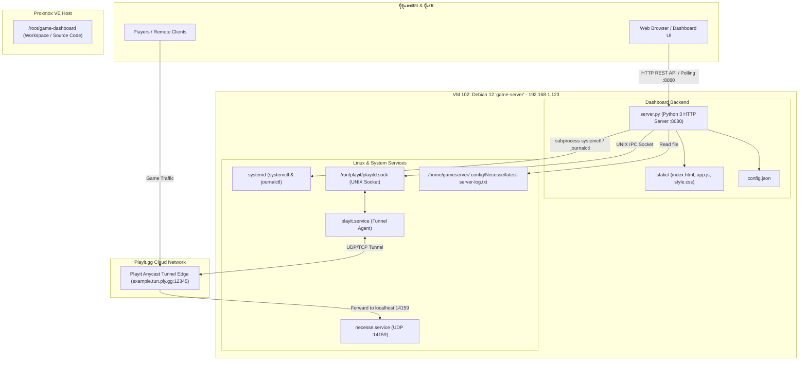

# 🎮 Game Server Dashboard

เว็บแดชบอร์ดขนาดกะทัดรัด (Lightweight Web GUI) สำหรับตรวจสอบสถานะ ควบคุม Game Servers และติดตาม Network Tunnels (Playit.gg) บน Linux แบบเรียลไทม์

---

## 📌 จุดเด่นของโปรเจกต์ (Key Features)

* **Zero External Dependencies**: รันด้วย **Python 3 Standard Library** 100% ไม่ต้องติดตั้งแพ็กเกจ pip เพิ่มเติม
* **Systemd Controller**: ควบคุมการทำงานของ Service (Start, Stop, Restart, Enable, Disable) ได้โดยตรงผ่าน Web UI
* **Playit.gg IPC Integration**: เชื่อมต่อผ่าน Unix Domain Socket (`/run/playit/playitd.sock`) ดึงข้อมูล Tunnel, Public Address, Session, และ Traffic สดๆ
* **Tunnel Latency & Ping Monitoring**: วัดค่าความหน่วง (ICMP Ping / Latency) ของแต่ละ Tunnel ไปยัง Anycast Edge Node แบบ Real-time พร้อม Color Coded Status (เขียว/ส้ม/แดง)
* **Real-time Server Metrics**: มอนิเตอร์ CPU, RAM, Disk, และ Uptime ของเครื่องแม่ข่าย
* **Game Players Detection**: ตรวจจับจำนวนผู้เล่นออนไลน์และรายชื่อผู้เล่นจาก Server Log (รองรับ Necesse และสามารถขยายเพิ่มได้)
* **Real-time Log Viewer**: ดูบันทึกการทำงานสดผ่าน `journalctl` พร้อมระบบ Auto-scroll และคัดลอก Logs
* **Modern UI**: ออกแบบด้วย Tailwind CSS (CDN) รองรับ Dark Mode, Responsive Design บนมือถือและแท็บเล็ต

---

## 🏗️ สถาปัตยกรรมระบบ (System Architecture)



---

## 📂 โครงสร้างโปรเจกต์ (Project Structure)

```text
/opt/game-dashboard/ (หรือ /root/game-dashboard/)
├── config.json             # ไฟล์คอนฟิกหลักสำหรับระบุรายการเกมและพอร์ตเซิร์ฟเวอร์
├── server.py               # Backend Web Server (API + Static File Handler)
├── game-dashboard.service  # ไฟล์ Unit Service สำหรับ systemd
├── data/                   # โฟลเดอร์สำรองข้อมูลสถานะ (Runtime cache/data)
└── static/                 # ส่วน Frontend Web Application
    ├── index.html          # โครงสร้างหน้าเว็บหลักและ Modal ต่างๆ
    ├── app.js              # ตรรกะฝั่ง JavaScript (Polling, Rendering, API Calls)
    └── style.css           # สไตล์เพิ่มเติมและการปรับแต่ง Animations
```

### หน้าที่ของแต่ละไฟล์
* **`server.py`**:
  * รัน HTTP Server บนพอร์ต 8080 ด้วย `ThreadingMixIn`
  * อ่านค่า Resource เครื่องจาก `/proc/stat`, `/proc/meminfo`, `/proc/uptime`
  * จัดการ Endpoint REST API สำหรับสถานะ, ล็อก, และการควบคุมเกม
  * มีฟังก์ชัน `get_playit_details()` คอยยิงคำขอ JSON ผ่าน Unix Domain Socket ไปที่ `playitd`
  * มีฟังก์ชัน `get_game_players()` สแกน Log ไฟล์ของเกมเพื่อนับจำนวนผู้เล่น
* **`config.json`**:
  * เก็บรายการเกมที่ให้แสดงในระบบ สามารถเพิ่ม/ลบ/แก้ไขผ่าน UI ได้แบบไม่ต้อง restart server
* **`static/app.js`**:
  * โพลล์ข้อมูลจาก `/api/status` ทุกๆ 4 วินาที (ปรับเปลี่ยนได้ใน UI)
  * จัดการการแสดงผลการ์ดเกม, สวิตช์เปิด/ปิด, Modal ดู Logs, และหน้าต่างข้อมูล Playit Tunnels

---

## 🔌 API Endpoints Reference

| Method | Endpoint | รายละเอียด | พารามิเตอร์ / Body |
| :--- | :--- | :--- | :--- |
| `GET` | `/api/auth/me` | ตรวจสอบสถานะการ Login ของผู้ใช้ปัจจุบัน | - |
| `POST` | `/api/auth/login` | เข้าสู่ระบบด้วยบัญชีผู้ใช้ Linux OS (เช่น `bioheart`) | `{"username": "...", "password": "..."}` |
| `POST` | `/api/auth/logout` | ออกจากระบบและลบ Session Cookie | - |
| `GET` | `/api/status` | ดึงสถานะเครื่องแม่ข่าย, รายการเกมทั้งหมด, และสถานะ Playit.gg *(ต้องล็อกอิน)* | - |
| `GET` | `/api/logs` | ดึง Systemd Logs ของ service ที่ระบุ *(ต้องล็อกอิน)* | `?service=<name>&lines=<number>` |
| `GET` | `/api/detect-services` | ค้นหารายชื่อ service ในระบบที่พร้อมนำมาเพิ่มใน Dashboard *(ต้องล็อกอิน)* | - |
| `POST` | `/api/action` | สั่งการ service (`start`, `stop`, `restart`, `enable`, `disable`) *(ต้องล็อกอิน)* | `{"service": "...", "action": "..."}` |
| `POST` | `/api/games/add` | เพิ่มการ์ดเกมใหม่เข้าสู่ระบบ *(ต้องล็อกอิน)* | `{"name": "...", "service": "...", "port": 1234, ...}` |
| `POST` | `/api/games/edit` | แก้ไขข้อมูลการ์ดเกมที่มีอยู่ *(ต้องล็อกอิน)* | `{"id": "...", "name": "...", ...}` |
| `POST` | `/api/games/delete` | ลบเกมออกจาก Dashboard *(ต้องล็อกอิน)* | `{"id": "..."}` |

---

## 🔐 ระบบความปลอดภัยและการยืนยันตัวตน (Authentication)

* **Linux OS User Login**: ยืนยันตัวตนโดยตรงกับบัญชีผู้ใช้จริงบนระบบปฏิบัติการ Linux (ผ่าน **PAM** และ fallback **`/etc/shadow`**)
* **รองรับผู้ใช้ `bioheart`**: ผู้ใช้สามารถกรอกชื่อผู้ใช้ `bioheart` และรหัสผ่านเดียวกันกับที่ใช้ล็อกอินเครื่อง OS เพื่อเข้าสู่ระบบได้ทันที
* **Configurable Access**: กำหนดรายชื่อผู้ใช้ที่อนุญาตให้ล็อกอินได้ใน `config.json` ผ่านฟิลด์ `auth.allowed_users`:
  ```json
  "auth": {
    "enabled": true,
    "allowed_users": [
      "bioheart",
      "root"
    ],
    "session_ttl_hours": 72
  }
  ```
* **Full Data Shielding**: หากยังไม่ได้เข้าสู่ระบบ หน้า Dashboard จะถูกซ่อนทั้งหมด แสดงเฉพาะแบบฟอร์มล็อกอิน และทุก Endpoint ของ API จะส่งค่า `401 Unauthorized` ทันที ป้องกันการแอบดูหรือสั่งการระบบ

---

## 🚀 การติดตั้งและเปิดใช้งาน (Setup & Installation)

### 1. การเปิดใช้งานแบบ Manual (สำหรับทดสอบ / พัฒนา)
```bash
cd /opt/game-dashboard
python3 server.py
```
เปิดบราวเซอร์ไปที่ `http://<IP-ของเซิร์ฟเวอร์>:8080`

### 2. การติดตั้งเป็น Systemd Service (เปิดทำงานอัตโนมัติ)
```bash
# 1. คัดลอกไฟล์ Service ไปที่ systemd
cp /opt/game-dashboard/game-dashboard.service /etc/systemd/system/

# 2. รีโหลด systemd และเปิดใช้งาน
systemctl daemon-reload
systemctl enable --now game-dashboard.service

# 3. ตรวจสอบสถานะการทำงาน
systemctl status game-dashboard.service
```

---

## 🔄 ขั้นตอนการซิงค์ไฟล์ระหว่าง Host (Proxmox) ↔ VM 102

เนื่องจากไฟล์โค้ดหลักอยู่ใน Proxmox Host (`/root/game-dashboard`) และรันใช้งานจริงอยู่ใน **VM 102** (`/opt/game-dashboard`):

### คำสั่งคัดลอกไฟล์ไปยัง VM 102 (Deploy):
```bash
# ส่งไฟล์โค้ดทั้งหมดจาก Proxmox Host ไปยัง VM 102 (192.168.1.123)
scp -r /root/game-dashboard/* root@192.168.1.123:/opt/game-dashboard/

# สั่ง Restart Dashboard ใน VM 102 เพื่อโหลดโค้ดใหม่
ssh root@192.168.1.123 "systemctl restart game-dashboard.service"
```

### คำสั่งตรวจสอบสถานะใน VM 102:
```bash
qm guest exec 102 -- systemctl status game-dashboard.service
```

---

## ➕ การเพิ่มเกมใหม่ใน Dashboard

### วิธีที่ 1: เพิ่มผ่าน Web UI (แนะนำ)
1. เปิดหน้าเว็บ Dashboard
2. กดปุ่ม **"+ เพิ่มเกม"** ที่มุมขวาบน
3. กรอกชื่อเกม, ชื่อ Systemd Service (สามารถกดปุ่ม "ตรวจจับ" เพื่อดูว่ามี service นี้จริงหรือไม่), พอร์ต, และเลือกไอคอน
4. กดบันทึก ระบบจะบันทึกลง `config.json` ทันที

### วิธีที่ 2: เพิ่มลงใน `config.json` โดยตรง
```json
{
  "id": "palworld",
  "name": "Palworld Server",
  "service": "palworld",
  "port": 8211,
  "protocol": "UDP",
  "category": "game",
  "description": "Palworld Dedicated Server",
  "icon": "gamepad"
}
```

---

## 🛠️ การแก้ไขปัญหาที่พบบ่อย (Troubleshooting)

| ปัญหา | สาเหตุ | วิธีแก้ |
| :--- | :--- | :--- |
| **Playit ข้อมูลไม่ขึ้น / แสดง Error** | Playit daemon ไม่ได้รัน หรือ socket path ไม่ถูกต้อง | ตรวจสอบว่า `systemctl status playit` กำลังทำงาน และมีไฟล์ `/run/playit/playitd.sock` อยู่จริง |
| **กด Start/Stop แล้วไม่ตอบสนอง** | สิทธิ์ของ process ไม่มี permission เรียก `systemctl` | แดชบอร์ดจำเป็นต้องรันด้วย root หรือมี sudoers permission สำหรับคำสั่ง `systemctl` |
| **ผู้เล่นไม่ขึ้นแสดงผล (0/0)** | Log parser ยังไม่รองรับเกมนอกเหนือจาก Necesse | เพิ่มตรรกะ Regex ในฟังก์ชัน `get_game_players()` ในไฟล์ `server.py` |
| **หน้าเว็บไม่แสดงผล / โหลดไม่ได้** | Firewall บล็อกพอร์ต 8080 หรือ Service หยุดทำงาน | ตรวจสอบด้วย `ss -tulpn \| grep 8080` และเปิด firewall พอร์ต 8080 |
